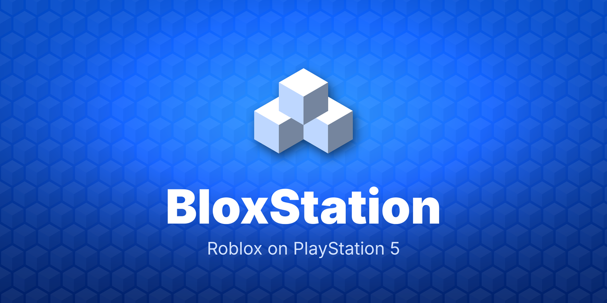

# BloxStation



**Roblox on PS5**, running natively on a jailbroken PlayStation 5: Roblox's
own Android engine (`libroblox.so`, x86_64), loaded by a native PS5 title and
drawn with the RADV Vulkan driver on the console's GPU. No PC, phone or
streaming is needed while playing.

> **Unofficial and experimental.** Not affiliated with Roblox or Sony. Roblox
> may restrict accounts that use unofficial clients; use a spare account for
> testing. This repository contains no Roblox or Sony files: you supply the
> Roblox app files from your own copy.

## Download

Get the title from [Releases](../../releases): unzip, copy `PPSA99187` to the
console and add the Roblox app files from your own copy, as `INSTALL.txt`
explains. Nothing needs building.

## What works

| Feature | State |
|---|---|
| Sign-in, Home, Avatar, Chat, More | works |
| Joining games and staying in them (longest test: 1 hour) | works |
| DualSense in menus and games; touchpad as a mouse (remembered per game) | works |
| PS5 on-screen keyboard for search, chat and text boxes | works |
| Sound | works |
| On-screen Guide: every control and every box under More (opens for new players, and from Guide in the left menu) | works |
| Roblox web pages (Messages, Settings pages, Servers > Join) in the PS5 browser; Circle closes them | works |
| 120 Hz menus, games above 60 fps | works |
| Built-in network tunnel (Cloudflare WARP) for networks that block Roblox | works |
| Each console registers its own tunnel identity on first launch | works |
| Tunnel finds a reachable server by itself (378 address/port pairs) and remembers it | works |
| Game traffic over UDP goes through the tunnel (fixes error 279 where game servers are blocked) | works |
| Countries that block WireGuard itself (deep packet inspection) | no |
| Circle going back one page inside a web page | no: it closes the page |
| Other Roblox versions than 2.746.1266 | no |

Tested on one PS5 (firmware 13.60) in Qatar. The PS5's web browser can stop
with error CE-108262-9 after many pages; restarting the PS5 fixes it.

## How it works

- **Loader** (`radv/android_probe/android_elf_loader.h`): maps the Android
  shared library into the PS5 title and resolves its imports.
- **Bionic and JNI** (`bionic_shims.h`, `bionic_net.h`, `fake_jni.h`): the
  Android C library and the Java side the engine calls, implemented on the
  PS5's FreeBSD-based system, including Linux system calls the engine makes
  directly.
- **Graphics** (`roblox_vulkan.h`): the engine's Vulkan calls go to RADV
  (Mesa's AMD driver, ported to the PS5). It is linked in as a prebuilt archive.
- **Input, audio, keyboard, accounts, browser** (`roblox_*.h`): DualSense,
  `sceAudioOut`, the PS5 on-screen keyboard and the PS5 web browser dialog.
- **Network** (`radv/android_probe/warp/`): an in-title SOCKS5 gateway over a
  WireGuard tunnel to Cloudflare WARP (lwIP + wireguard-lwip). Name lookups
  happen inside the tunnel. `web_relay.c` serves roblox.com pages to the
  PS5 browser through it (BearSSL TLS).

See [docs/HOW_IT_WORKS.md](docs/HOW_IT_WORKS.md) for details.

## Requirements

- A PS5 running a jailbreak with an ELF loader and **ShadowMount+** (homebrew
  titles from `/data/homebrew/`). Tested on firmware 13.60.
- FTP access to the console (for example `ftpsrv` or `zftpd`).
- The Roblox Android app **2.746.1266, x86_64** (`com.roblox.client`). The
  shims match this exact version.
- A Linux PC to build: clang/clang++ 18 or newer, lld, python3,
  glslangValidator, curl, unzip.

## Build

```sh
tools/setup-native-dependencies.sh      # PS5 payload SDK + zlib into .deps/native
# RADV for the PS5: put the prebuilt release in .deps/native/radv-release
# (lib/libvulkan_radeon.ps5.a and include/) - see docs/BUILD.md
tools/build-radv-title.sh               # -> dist/PPSA99187
```

Details, the RADV archive and tests: [docs/BUILD.md](docs/BUILD.md).

## Install

1. Copy `dist/PPSA99187/` to `/data/homebrew/PPSA99187/` on the console.
2. From your Roblox APK, copy `lib/x86_64/libroblox.so` to
   `/data/homebrew/PPSA99187/libroblox.so` and the APK's `assets/` folder to
   `/data/homebrew/PPSA99187/assets/`.
3. Create `/data/homebrew/PPSA99187/radv-smoke-env.txt` with:
   ```
   RADV_SMOKE_ONLY=demo
   ROBLOX_STAGE=activity
   ROBLOX_OPENAT_TEST=1
   ```
   `ROBLOX_OPENAT_TEST=1` is required. Without it, games disconnect after
   about a minute.
4. Wait for ShadowMount+ to register the title (about 45 s), then start
   **Roblox** from the home screen. On first launch the title registers its own
   tunnel identity; then sign in.

For development, `PS5_HOST=<console ip> radv/android_probe/roblox_cycle.py`
builds, uploads the new `eboot.bin` and relaunches the title.

## Controls

The first time each player reaches Home, the on-screen **Guide** opens: every
control, every box under More, games, mouse, typing, web pages and what to do
when something goes wrong. Open it again from **Guide** in the left menu
(docs/BUILD.md: `tools/patch-ui.sh` adds it and the BloxStation blue look);
L1 / R1 turn pages, Circle closes it. In short:
the D-pad and left stick move around menus, Cross selects, Circle goes back.
Hold the touchpad for one second in a game that needs a mouse; the title then
remembers that game.

## Privacy and security

- Sign-in cookies and the tunnel key stay on the console, under
  `/data/roblox/files/`, as files only the title reads. They are never
  uploaded anywhere except to Roblox and Cloudflare.
- Each console makes its own tunnel key. No key is shared or included here.
- See [SECURITY.md](SECURITY.md).

## Credits and license

GPL-3.0-or-later; see [LICENSE](LICENSE) and [NOTICE.md](NOTICE.md). Based on
[PS5_Vulkan](https://github.com/mpereiraesaa/PS5_Vulkan) (RADV on the PS5) and
its native-title tooling. Uses lwIP, wireguard-lwip and BearSSL (see
`third_party/`).
